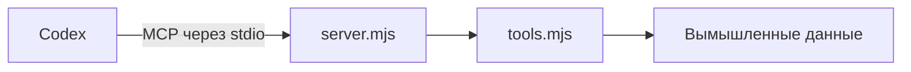

# Учебный плагин «1С»

Плагин используется в тестовом задании по поддержке AI-инструментов. Сервер предоставляет справочники и существующие документы, проверяет данные отправления и дубли, формирует предпросмотр. Для проверки сценариев доступны имитация входа без учётных данных и проверка вымышленного платёжного реестра. Пробная загрузка принимает результат обязательной проверки для тех же реквизитов.

В папке `plugins/dvs-training-onec/` находятся манифесты, процесс MCP и определения команд. Сервер работает локально, не хранит учётные данные и не подключается к рабочим сервисам. Проверка и пробная загрузка не изменяют внешних данных.

Установка описана в [README](../../README.md). При изменении компонентов, интерфейсов или границ обновите эту карту.
